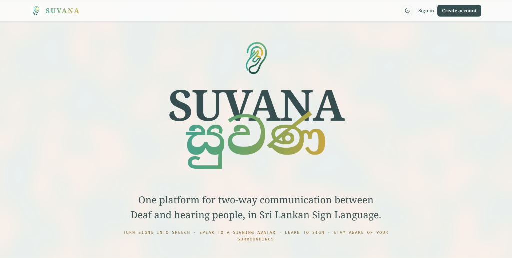

# සුවණ Suvana



One platform for real-time two-way Deaf–hearing communication in Sri Lankan Sign Language (SSL). Integrated, single-brand build of the four components of SLIIT IT4010 research project **R26-SE-019** (Jan 2026 cohort). There are no sub-brands inside Suvana — the names the components were built under standalone (Sawana, SignSpeak, SoundGuard) live only in their source repos.

## Structure

| Path | Module | Stack |
|---|---|---|
| `apps/shell` | The Suvana landing and the **Alerts** page at `/alerts/`, plus the built-in **Suvana AI** tutor — owns the domain root and proxies the modules | Static HTML + TypeScript, Vite (dev proxy + build) |
| `apps/learn` | **Learn** — gamified SSL learning & practice, served at `/learn/` | React + Vite, MediaPipe Tasks Vision in-browser, DTW scoring |
| `apps/communicate` | **Communicate** — speech → 3D signing avatar, with audio emotion recognition | Next.js 16 full-stack (MongoDB + Auth.js, Cloudinary, Three.js); ASR/emotion served externally |
| `apps/alerts` | **Alerts** — sound awareness / SOS companion app | Expo / React Native, TF.js |
| `services/recognition` | **Recognize** — sign → speech: browser-side capture streamed over a WebSocket, plus its own Suvana-branded frontend | FastAPI + TensorFlow + MediaPipe |
| `services/sound-awareness` | Sound-classification backend utilities for the mobile app | Python |
| `services/speech` | Sinhala Whisper ASR + audio emotion service (extracted from the Colab notebook; deploys as a Docker container, e.g. a Hugging Face Space) | FastAPI + PyTorch |
| `tools/reference-converter` | Dataset video → landmark reference pipeline feeding `apps/learn` | Python + MediaPipe |
| `packages/branding` | Suvana palette tokens and logos | — |

## Provenance

Fresh-history monorepo bootstrapped **24 Aug 2026** from working-tree snapshots. Full histories remain in the source repos.

| Path | Source | Commit |
|---|---|---|
| `apps/shell` | `ChamaraIT22076816/R26-SE-019` → `learn-ssl-module/` | `7f6fc4f` at bootstrap; Suvana's own since, no longer synced |
| `tools/reference-converter` | `ChamaraIT22076816/R26-SE-019` → `learn-ssl-module/tools/` | `7f6fc4f` (+3 Suvana-side changes not yet in R26 — see below) |
| `apps/learn` | `ChamaraIT22076816/R26-SE-019` → `learn-ssl-module/web/` | `334beba` (re-sync, 10 Oct 2026 — see below) |
| `services/recognition` | `ChamaraIT22076816/R26-SE-019` → `sinhala_sign_language_recognition/` | `334beba` (re-sync, 10 Oct 2026 — see below) |
| `apps/alerts`, `services/sound-awareness` | `ChamaraIT22076816/R26-SE-019` → `soundguard-karindra/` | `7f6fc4f` (nothing newer upstream as of 10 Oct 2026) |
| `apps/communicate` | [`lithiraMalkith/Sign-Detector`](https://github.com/lithiraMalkith/Sign-Detector) | `48ab8cb` (re-sync, 10 Oct 2026 — see below) |

The machine-readable version of this table — plus every file Suvana changes on
purpose, and why — is `tools/sync/upstreams.json`. `node tools/sync/sync.mjs
status` compares it with the upstreams; `tools/sync/README.md` is the procedure.

### Re-sync log

**10 Oct 2026 — all components checked; `apps/learn` and `apps/communicate` merged.**

*`apps/learn`, `2d85c78` → `334beba` (merge).* 31 commits of kvn's Learn work
(31 Aug – 10 Oct): the Progress dashboard, Record phases A–E, Scenario polish,
a Practice studio overhaul, and a new `AppNavBar` that replaced the old header.
Every non-coupling file is now byte-identical to upstream. The four couplings
survived; `App.tsx` conflicted because the header moved, so Suvana's account
link was rebuilt for the new bar:

- It is now a **round 32 px button** (initial when signed in, gold dot for an
  admin; person icon when signed out), in `src/app/AccountButton.tsx`. A
  straight port of the old text link overflowed phones — a 490 px page on a
  390 px screen — and shifted the centred tabs whenever a name loaded.
- On phones it takes the place of the "On-Device AI" dot, and below 380 px the
  button gaps close slightly; both rules apply only when an account is present.
  Measured: no overflow at 390 or 360 px, and the tabs sit in the same place
  in every sign-in state.
- `AppNavBar` gained an optional `account` slot. The same 6-line change is
  prepared in R26 so the file stays identical in both repos; until R26 commits
  it, `upstreams.json` lists it as a temporary coupling.

138 tests pass (129 at the last sync; the opt-in `evaluation.export.test.ts`
is skipped unless `EVAL_EXPORT=1`), lint has two warnings that are upstream's
own, build clean.

*`services/recognition`, checked at `334beba`.* The only new commit, Lahiru's
`c2a401f`, appended "(Unit Testing)" to the README's pytest command, which
would no longer run if pasted. Taken as a `# Unit testing` comment above the
unchanged command. Backend, model and tests: unchanged since 30 Aug.

*`apps/communicate`, `6fdfd04` → `48ab8cb` (merge).* Taken: `3aaa7b0`
(multi-word Sinhala glosses — greedy longest-phrase matching) and `48ab8cb`
(avatar oversized on first load). **Not taken, deliberately: `7948c4a`**, which
closes registration. Lithira closed it because friends he gave accounts to for
collecting audio samples might have recorded inappropriate audio; they have no
Suvana access, Suvana's shared-content writes are already admin-only
(`3e07d2f`), and Communicate is the whole platform's sign-up. Its Navbar half
merges cleanly, so a sync guard now protects the Sign-up button.

*Found by the new sync guards, fixed here:* `SignAvatar.tsx` and
`SignDictionaryWorkbench.tsx` fetched `/api/animations/fetch` without
`apiPath()`. Under the `/communicate` base path that request reaches the shell,
which has no such route — a 404 whenever an animation needed the server-side
fetch. Lint and production build clean.

*Unchanged upstream:* `apps/alerts`, `services/sound-awareness` (both still
`7f6fc4f`).

*Still open:*

- `tools/reference-converter` carries three Suvana-side changes from 26 Aug
  (`31c2d49`, the `.mov` fix; `d3432eb`, `dde167d`, docs) that R26 never
  received. `sync.mjs status` keeps flagging them until they are ported.
- `services/recognition/requirements.txt` pins fastapi 0.103.2, uvicorn 0.23.2
  and websockets 11.0.3 (`8ecb443`, no reason recorded), while upstream and
  Lahiru's own venv run 0.141.1 / 0.52.1 / 16.1.1. Verify the Docker build
  before converging.

**30 Aug 2026 — `apps/learn`, `7f6fc4f` → `2d85c78` (merge, not copy).**

The team repo carried three days of newer Learn work: the Practice redesign
(one card system, iconified controls, mobile tab-bar fixes, capture-failure vs
low-score results), `CategorySignNavigator`, a fourth hero step, reduced-motion
handling, and Lenis scoped to the hero instead of running globally and
hijacking every scroll container in the app.

That copy is deployed **standalone** from the team repo, so its commit
`3e38643` deliberately stripped four Suvana couplings. All four are re-applied
here and must survive every future re-sync:

| Coupling | Where |
|---|---|
| `base: '/learn/'`, `outDir: dist/learn`, port 5174 | `vite.config.ts` (kept, not taken) |
| `/learn/`-prefixed cache headers | `vercel.json` (kept, not taken) |
| `src/app/session.ts` + the account link in the app bar | `src/App.tsx`, `src/index.css` |
| Brand links home, "Back to Home" button | `src/components/Hero.tsx` |

129 tests pass; typecheck and production build clean.

**30 Aug 2026 — `services/recognition` backend, checked, nothing to take.**

Verified against the team repo at `2d85c78` (fetched; `origin/main` had nothing
newer). `server.py`, `assistant.py`, `soundguard.py`, `sinhala_labels.py`, both
build scripts, all of `src/`, all of `tests/` and both config files are
**identical**. The only commits touching that folder since the last sync
(`5f945db`, `2f826ad`, `327274a`) all edit `webapp/static/index.html` — the team
repo's own landing page, which embeds the other modules as panels. Suvana
integrates at the domain level instead, so those keep being skipped, exactly as
the 26 Aug entry below says. The Suvana copy's only intentional divergence is
its rebranded frontend, plus the UI strings noted next.

**30 Aug 2026 — `services/recognition/webapp/assistant.py`, UI copy only.**

Five user-visible strings still carried the module's standalone sub-brand name,
which Suvana UI copy does not use. Rebranded, plus a system-prompt rule so the
model does not reintroduce them. The engine is untouched: future re-syncs
should take upstream logic and re-apply those strings. See the module docstring.

**26 Aug 2026 — `services/recognition`, `7f6fc4f` → `8a2ff2f` (selective).**

Taken: `tests/test_keypoint_augmentation.py` and `tests/test_sinhala_labels.py` (35 tests, numpy + a mocked `requests`, no TensorFlow or MediaPipe needed — all 35 verified passing against this copy), the pytest line in the component README, and `model_accuracy_graph.png`.

**Not taken, and not an oversight:** the same range added `webapp/static/learnssl.css`, `webapp/static/signspeak.css` and matching `index.html` sections. That is Lahiru's own integration approach in the team repo — embedding the other modules as panels inside the recognition page. Suvana integrates at the domain level instead (the shell owns routing and cross-module navigation), so importing those would duplicate the shell's job, re-introduce the sub-brand names "SignSpeak" and "Learn SSL" into Suvana UI copy, and collide with this copy's rebrand of the same file. Future re-syncs of this component should keep skipping them and take backend, model and test changes only.

~~`data/processed/labels.npy` is still absent upstream, so the label-map gap in `services/recognition/DEPLOY-SUVANA.md` remains open.~~ **Closed 30 Aug 2026**: `labels.npy`, `metadata.json` and `webapp/data/sinhala_labels.json` are committed here (~380 KB). They were caught by a bare `data/` ignore rule, so a clone got a service that started and logged `Loaded 0 gesture labels`. Do not regenerate them from the Kaggle corpus — the label order has to match the trained model's output indices exactly.

Deliberately excluded from every snapshot: git histories, `node_modules`, Python venvs, build outputs, datasets, and ~293 MB of Mixamo test FBX files (`lib/models` in Sign-Detector — nothing in code references them). The team repo's `SSL-Transformer/` folder was a stale placeholder and was not copied; the PP1 Python demo stays in the team repo as historical reference.

## One-domain topology

One domain serves the whole web product. The shell (`apps/shell`) owns the root; `apps/learn` builds with Vite `base: '/learn/'` and `apps/communicate` runs with Next `basePath` `/communicate` (set via `NEXT_PUBLIC_BASE_PATH`), which namespaces its pages, assets and API routes under that prefix, and the shell proxies it:

- **Production**: the `rewrites` in `apps/shell/vercel.json` forward `/learn/*` and `/communicate/*` to their own deployments. **Deploy order matters**: deploy `apps/learn` and `apps/communicate` first (each its own Vercel project; Communicate needs the env vars from `.env.local.example`), paste their production URLs over the `REPLACE-WITH-LEARN-DEPLOYMENT` / `REPLACE-WITH-COMMUNICATE-DEPLOYMENT` placeholders, then deploy `apps/shell`.
- **Dev**: the shell's Vite proxy maps `/learn` → `localhost:5174` and `/communicate` → `localhost:3000`, so `localhost:5173` mirrors production. Start all three dev servers.
- **`services/recognition` is the exception**: it streams camera frames over a WebSocket, and Vercel rewrites do not proxy WebSocket upgrades. It runs on its own origin (a `recognize.` subdomain or the container host) and serves its own Suvana-branded frontend, so it needs no CORS. See `services/recognition/DEPLOY-SUVANA.md`.
- Client code must never call `fetch("/api/...")` with a bare absolute path — route it through `apiPath()` from `lib/basePath.ts` (basePath does not rewrite raw fetches). Unset `NEXT_PUBLIC_BASE_PATH` and everything collapses to standalone behaviour, matching Lithira's original deployment.

## Running

- **`apps/shell`** — `npm install`, then `npm run dev` (port 5173). Serves the landing, the Alerts page at `/alerts/`, and proxies the other modules. `npm run build` typechecks first. See `DEMO.md` for running all four together.
- **`apps/learn`** — `npm install`, then `npm run dev` (port 5174, served under `/learn/`). The `predev` hook regenerates `public/reference-index.json`; running `npx vite` directly skips it and the app loads with no references. Runtime asset paths must use `import.meta.env.BASE_URL` — a bare `/references/...` breaks under the prefix.
- **`apps/communicate`** — `npm install`, copy `.env.local.example` → `.env.local` and fill it, then `npm run dev`. Needs MongoDB Atlas, an Auth.js secret, Cloudinary keys and the ngrok shared secret — all avatar models and gloss animations live in Cloudinary, not in this repo; the speech backend URL is read from MongoDB at runtime.
- **`apps/alerts`** — `npm install`, then `npx expo run:android` (a dev build is required: the app has a custom native module, so Expo Go will not run it).
- **`services/recognition`** — `pip install -r requirements.txt`, then see its README and `DEPLOY-SUVANA.md`. Capture is browser-side (`getUserMedia` → WebSocket), so it works off localhost. Locally it is simplest to borrow the team repo's venv rather than build a second 3 GB one — `DEMO.md` has the command. It needs two gitignored data files that never arrive with a clone; `DEMO.md` lists them and what breaks without them.

### Node version — pinned in `.nvmrc`

CI reads `.nvmrc`, so it runs the same Node (and therefore the same npm) as
this repo is developed on. That is not cosmetic. When CI pinned Node 22 (npm
10) while lockfiles were written on Node 24 (npm 11), `npm ci` refused the
install in both `apps/learn` and `apps/communicate`:

```
npm ci can only install packages when your package.json and package-lock.json are in sync.
Missing: @emnapi/runtime@1.11.3 from lock file
```

npm 11 omits some transitive `@emnapi/*` packages that `@napi-rs/wasm-runtime`
pulls in for its wasm fallbacks, and then accepts its own lockfile — so the gap
was invisible locally and only ever failed in CI. Note that
`npm ci --dry-run --os=linux --cpu=x64` does **not** catch it either: the
missing entries are not platform-specific, so the platform flags change
nothing. Reproduce a CI install with the version CI uses, not with flags:

```
npx -y npm@10 ci --dry-run --prefix apps/<app>
```

The committed lockfiles are npm 10 output, which both majors accept, so they
stay valid if the pin ever moves back down. Only `apps/learn` and
`apps/communicate` are affected — they are the two that reach
`@napi-rs/wasm-runtime`, via rolldown and Tailwind's oxide binding
respectively.

## The built-in assistant

The shell ships **Suvana AI**, a tutor over the 171 signs the recognition model
was trained on. It runs entirely in the browser:

- **Knowledge base** — `apps/shell/public/data/signs.json`, committed, built by
  `apps/shell/scripts/build-sign-index.py` from the recognition module's label
  data and its English gloss map. Rebuild it after a retrain.
- **Retrieval and intents** — `apps/shell/src/assistant/`, a port of the engine
  in `services/recognition/webapp/assistant.py`, scoring kept numerically
  identical (including a faithful `difflib.SequenceMatcher` ratio) so answers do
  not drift between the two surfaces.
- **Model access** — `api/assistant`, a Vercel Edge function on the shell's own
  project that holds `GEMINI_API_KEY` server-side. Visitors get conversational
  replies without bringing a key, and the key never reaches the browser: a key
  shipped to a static page is a published key, and no amount of minifying or
  encoding changes that. `src/assistant/handler.ts` is the function's body,
  kept separate so the Vite dev server runs the identical code on localhost.
  With the variable unset the endpoint answers 503 and the widget quietly uses
  its local engine — a deployment with no model access is supported, not
  broken.
- **A personal key** — still available under *Advanced* in the widget's gear,
  for a deployment that has no access of its own. It stays in that browser and
  is sent only to Google.

In every case the local engine retrieves first and its hits are injected as
grounded context, and every failure falls back to the local answer.

The point of the port is that it depends on **no Suvana service**. The Python
original reads a gitignored file next to a 3 GB TensorFlow container, so it
answered "0 signs" on a fresh checkout and went down whenever recognition did.
The copy on the Recognize page is unchanged and still needs that file — see
`DEMO.md`.

## Licences

Reference corpora in `apps/learn`: `kaggle_*` files are CC0; `yohan_*` files are **CC BY-NC-SA 4.0 (non-commercial)**. Licence files ship alongside the data.

## Near-term work

1. ~~Branding pass~~ and ~~one-domain topology~~ — done. All four modules are
   reachable from the landing, and no sub-brand name remains in UI copy.
2. Extract `services/speech` from the notebooks and point `apps/communicate` at a persistent URL (a DB config write — no code change). Until then Communicate transcription is UI-only.
3. Get `data/processed/labels.npy` committed somewhere durable, or accept that Recognize needs a manual file drop on every fresh clone.
4. Build the Alerts dev client and put an APK somewhere `/alerts/` can link to, so the page can offer a download rather than a build command.
5. Unified sign-on across modules is documented future work, not current scope.
